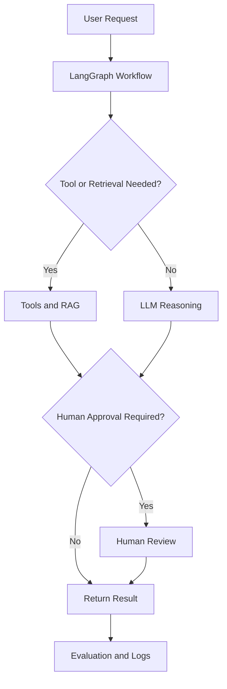

<!-- =========================================================
     KANALPREET KAUR | GITHUB PROFILE README
     Repository: https://github.com/Kanalpreet/Kanalpreet
     Requires these three SVG files in the same folder as this README:
       header.svg · terminal.svg · footer.svg
     ========================================================= -->

  

  

---

## 👋 About Me

I'm a final-year **B.Tech CSE (AI & ML)** student and a **Backend AI Engineering Intern at FlyRank AI**. I'm interested in building practical AI systems that combine LLMs, agentic workflows, and backend engineering to solve real-world problems, with a focus on reliability, evaluation, and responsible automation.

| | |
|---|---|
| 🎓 **Education** | B.Tech CSE (AI & ML), IK Gujral Punjab Technical University · **CGPA: 8.75/10** · Class of 2027 |
| 💼 **Current Role** | Backend AI Engineering Intern @ FlyRank AI |
| 🔬 **Previous Role** | Data Science Intern @ CBA Infotech |
| 🎯 **Interests** | Applied AI, Agentic Systems, RAG, Generative AI, and Backend Engineering |

---

## 🔭 Currently

- 🧾 **Building:** An AI Procurement Agent using LangGraph, FastAPI, and PostgreSQL.
- 🤖 **Exploring:** Agentic AI workflows, LLM-powered applications, and backend AI systems.
- 📐 **Learning:** RAG evaluation, agent orchestration, and AI guardrails.

---

## 💼 Experience

<table>
  <tr>
    <td width="30%" valign="top">
      <strong>Backend AI Engineering Intern</strong> 
      FlyRank AI 
      Jul 2026 – Present
    </td>
    <td valign="top">
      Building FastAPI backend APIs and contributing to RAG pipelines for AI-powered document retrieval systems.
    </td>
  </tr>
  <tr>
    <td width="30%" valign="top">
      <strong>Data Science Intern</strong> 
      CBA Infotech 
      Add your internship dates
    </td>
    <td valign="top">
      Worked on data preprocessing, machine learning model development, and data analysis to build predictive solutions.
    </td>
  </tr>
</table>

---

## 🚀 Featured Projects

### 🏦 RegMind AI — Regulatory Compliance Intelligence

> An AI-powered regulatory compliance system designed to identify potential conflicts between RBI regulations and internal organizational policies.

- **Stack:** React · FastAPI · Qdrant · Hybrid RAG
- **Retrieval:** BM25 and dense vector search combined using Reciprocal Rank Fusion (RRF).
- **Risk Analysis:** XGBoost-based compliance-risk classification.
- **Evaluation:** Testing retrieval and generation quality to identify fabricated clause references and improve retrieval reliability.
- 🔗 **Repository / Demo:** Add your project links when available.

### 📊 Student Performance Prediction System

A machine learning project that predicts student performance using a structured data pipeline, model tuning, and a web-based prediction interface.

- **Approach:** Data preprocessing, model training, and hyperparameter tuning using GridSearchCV and cross-validation.
- **Model:** CatBoost.
- **Deployment:** Flask REST API deployed on Render.
- **Repository:** [View on GitHub](https://github.com/Kanalpreet/mlproject)

### 🧾 AI Procurement Agent *(In Progress)*

> An agentic procurement workflow that finds suppliers, requests quotations, compares offers, and seeks human approval before purchase commitments.

- **Stack:** Python · FastAPI · LangGraph · PostgreSQL
- Flags missing or conflicting supplier information instead of guessing.
- Performs cost comparisons using deterministic code.
- Supports persistent workflows and recovery after restarts.
- Requires human approval before purchase commitments.
- Includes repeatable evaluation scenarios for testing failure cases.
- 🔗 **Repository:** Add the link when the project is public.

### 🌾 FarmCulture — AI-Powered Crop Recommendation

A crop recommendation project using machine learning and generative AI to support cultivation decisions based on information such as soil type, rainfall, temperature, and location.

- **Stack:** Python · Random Forest · Gemini API · FastAPI · React · Bootstrap
- **Recognition:** Presented at NIT Hamirpur.
- **Repository:** [View FarmCulture](https://github.com/vanshbhutani1405/FarmCulture)

<strong>📂 More Machine Learning Projects</strong>

 

| Project | Description | Technologies |
|---|---|---|
| [Book Recommendation System](https://github.com/Kanalpreet/recommendationSystem) | Recommends books using collaborative filtering and cosine similarity. | Python · scikit-learn |

---

## 🧭 How I Approach AI Systems

**Engineering principles**

1. **Ground outputs in data:** Flag missing information instead of inventing details.
2. **Evaluate early:** Treat failure cases as test cases.
3. **Keep humans involved:** Require approval for consequential or irreversible actions.
4. **Use deterministic code:** Handle calculations and validation in code wherever possible.
5. **Make systems traceable:** Maintain logs and document limitations.

---

## ⚙️ Tech Stack

**AI / LLM / Retrieval**

**Backend & Data**

**Frontend**

**Machine Learning**

**Languages:** Python · C++ · SQL · C · JavaScript

---

## 📜 Certifications

---

## 📊 GitHub Stats

---

## 🤝 Let's Connect

🎯 **Looking for:** An AI Engineer role where I can own what I build and learn something new every week.

  

